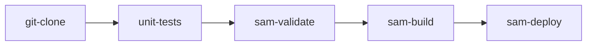

# Serverless Application: serverless-demo

Production serverless service built with **AWS SAM** and deployed continuously via **Tekton Pipelines**.
Runs natively on **AWS Lambda Managed Runtimes** with standard Zip packaging (**zero container overhead / no Docker required**).

## Overview

- **Service Name**: `serverless-demo`
- **Runtime**: `nodejs20.x` (Native AWS Lambda Managed Runtime)
- **Packaging Mode**: **Zip (Container-less)**
- **Trigger**: `api-gateway`
- **Persistence (DynamoDB)**: `true`
- **AWS Region**: `eu-south-1`
- **Environment**: `dev`
- **Mandatory Ownership Contract**: Every AWS resource (CloudFormation stack, Lambda function, API Gateway, SQS Queue, EventBridge Rule, DynamoDB table, and IAM Role) is tagged:
  ```yaml
  Owner: so.amin
  ```

---

## How to Show This Working (Live Demo)

### 1. Interactive Web Dashboard in Browser
When invoking the API Gateway URL (or local test endpoint) from any web browser, the Lambda automatically renders a **live interactive status console**:
- **URL**: `https://<api-id>.execute-api.eu-south-1.amazonaws.com/dev/`
- **What it demonstrates**:
  - Live AWS Lambda microVM execution with Request ID and cold/warm state
  - Zero container overhead confirmation (`Runtime: nodejs20.x`)
  - Enforced governance tag `Owner: so.amin`
  - **Interactive DynamoDB write/read button**: Type a test message and click *Save to DynamoDB* to verify real-time persistence.
  - **Live health check button**: Queries `/api/health` and displays JSON metrics with round-trip latency.

### 2. Local Execution (No Docker / Container required)
Run the unit test suite locally to verify all endpoints, HTML rendering, and trigger handling:
```bash

# Run native Node.js tests
npm test

```

### 3. Programmatic API Invocations (curl / JSON)
```bash
# Health check endpoint
curl -X GET https://<api-endpoint>/api/health

# Create audit record in DynamoDB
curl -X POST https://<api-endpoint>/api/records \
  -H "Content-Type: application/json" \
  -d '{"message": "Demonstration record", "sender": "colleague-demo"}'
```

---

## Directory Layout

```tree
.
├── .tekton/
│   ├── pipeline.yaml       # Orchestrates: clone -> unit-tests -> sam-validate -> sam-build -> sam-deploy
│   ├── pipelinerun.yaml    # Manual/direct pipeline execution spec
│   ├── sam-tasks.yaml      # Custom Tekton tasks for SAM build and CloudFormation deployment
│   └── triggers.yaml       # GitHub push EventListener, TriggerBinding and TriggerTemplate
├── catalog-info.yaml       # Backstage Component registration
├── samconfig.toml          # AWS SAM deployment parameters with mandatory Owner=so.amin tag
├── sam-template.yaml       # AWS SAM infrastructure & function definition
├── src/                    # Lambda function source code (app.mjs or app.py)
└── tests/                  # Unit test suites
```

---

## Tekton CI/CD Pipeline

The build and deployment workflow executes through Tekton without needing container builds:



### Automatic Triggering on Git Push

Commits pushed to branch `main` trigger the Tekton `EventListener`:
```bash
kubectl -n tekton-pipelines port-forward service/el-serverless-demo-listener 8080:8080
```
Configure GitHub Webhook:
- **URL**: `http://<ingress-url>/`
- **Content type**: `application/json`
- **Events**: `push`

### Manual Pipeline Trigger

Execute with `kubectl`:
```bash
kubectl create -f .tekton/pipelinerun.yaml
```
